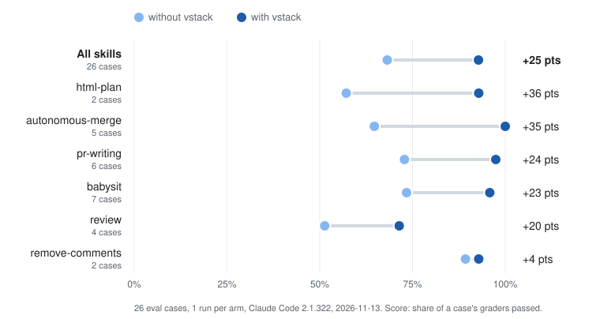

# vstack


Personal agent skills, packaged as one plugin (`vstack`) for Claude Code, Codex, GitHub Copilot, Antigravity and Gemini CLI.

- `autonomous-merge`: run `review` and `babysit` in a capped loop, then merge through a live gate without asking (`/autonomous-merge <pr> no-merge` to stop at ready; Bitbucket PRs are handed back for you to merge), hands back anything that needs you
- `babysit`: watch a PR until it's green and approved, fixing and replying as needed (`/babysit <pr> merge` or "and merge when green" to merge; `--merge` also works)
- `html-plan`: write an implementation plan as one interactive HTML page
- `pr-writing`: open PRs, write their descriptions, reply to reviewers and post PR comments in text that reads like a person wrote it. Descriptions summarise what changed and why without spec-level detail, with a small Mermaid sketch only when a complex change's shape matters. Replies give the answer first, short, no "good catch" or "you're absolutely right", and the same plain, polite answer to a rude comment as to a polite one (`/pr-writing 14`, `/pr-writing 14 description`, or "draft a reply to dave" to post nothing)
- `remove-comments`: delete comment noise from a change and check that no code changed
- `review`: read-only multi-lens code review of a PR, branch or path

`babysit` and `autonomous-merge` word their replies with `pr-writing`'s rules, and refresh a PR description their fixes made stale.

`babysit` and `autonomous-merge` work alongside other fixers (people, Copilot, Codex, Claude): they act only once the PR is settled, never touch an item someone else claimed, and merge only with nothing claimed.

`review` and `babysit` record each PR's outcome as JSON in `$(git rev-parse --git-common-dir)/vstack/<pr>/<skill>.json`, outside the working tree; read it with the skill's `scripts/read-result.py`.

## Does it help?

Each skill has eval cases that run the same prompt twice, once with vstack installed and once without, against a fake GitHub that logs every push, reply and merge. Graders check that log, the text it posted and the transcript: did it fix the failing check, reply to the question, merge only when asked, leave unrelated code alone. The chart shows the share of graders passed in each arm, on the smoke set (26 cases, including ones where the skill should stay out of the way). See [Evals](docs/contributing.md#evals) to run them yourself.

<!-- evals:start -->
<picture>
  <source media="(prefers-color-scheme: dark)" srcset="docs/evals-dark.svg">
  
</picture>

| Skill | Cases | Without vstack | With vstack | Change |
|---|--:|--:|--:|--:|
| **All skills** | 26 | 68% | **93%** | **+25 pts** |
| `html-plan` | 2 | 57% | 93% | +36 pts |
| `autonomous-merge` | 5 | 65% | 100% | +35 pts |
| `pr-writing` | 6 | 73% | 97% | +24 pts |
| `babysit` | 7 | 73% | 96% | +23 pts |
| `review` | 4 | 51% | 71% | +20 pts |
| `remove-comments` | 2 | 89% | 93% | +4 pts |

<sub>26 eval cases, 1 run per arm, Claude Code 2.1.322, 2026-11-13. Score: share of a case's graders passed.</sub>
<!-- evals:end -->

## Install

### Claude Code

```
claude plugin marketplace add VaggelisKa/vstack
claude plugin install vstack@vaggeliska
```

Use `/vstack:<skill>`. Update with `claude plugin marketplace update vaggeliska` then `claude plugin update vstack@vaggeliska`, remove with `claude plugin uninstall vstack@vaggeliska`. Claude Code doesn't auto-update third-party marketplaces unless you turn it on (`/plugin` → Marketplaces → vaggeliska → Enable auto-update), and `claude plugin marketplace update` alone refreshes the listing without updating the installed plugin. After `claude plugin update`, restart Claude Code or run `/reload-plugins`. The plugin has no `version`, so Claude Code versions it by commit: `claude plugin list` shows the commit SHA it has installed.

### Codex

```
codex plugin marketplace add VaggelisKa/vstack
codex plugin add vstack@vaggeliska
```

Use `$<skill>`. Update with `codex plugin marketplace upgrade vaggeliska`, remove with `codex plugin remove vstack@vaggeliska`.

### GitHub Copilot

CLI:

```
copilot plugin marketplace add VaggelisKa/vstack
copilot plugin install vstack@vaggeliska
```

Verified with Copilot CLI 1.0.104 (add, install, update, uninstall, marketplace remove). Update with `copilot plugin marketplace update vaggeliska` then `copilot plugin update vstack@vaggeliska`, remove with `copilot plugin uninstall vstack`. Invoke a skill by name, e.g. `/review` (per the docs; not run in a session).

VS Code (experimental, untested): add `"chat.plugins.marketplaces": ["VaggelisKa/vstack"]` to settings (needs `chat.plugins.enabled`), or install from the Extensions view (`@agentPlugins`), or run "Chat: Install Plugin From Source" with the Git URL; skills appear as `/vstack:<skill>`.

Cloud agent (untested): in the target repo's `.github/copilot/settings.json`, set `extraKnownMarketplaces` to `{"vaggeliska": {"source": {"source": "github", "repo": "VaggelisKa/vstack"}}}` and `enabledPlugins` to `{"vstack@vaggeliska": true}`.

A project or personal skill with the same name silently overrides the plugin's.

### Antigravity

```
agy plugin install https://github.com/VaggelisKa/vstack
```

Use `/vstack:<skill>`. Update by uninstalling and installing again; remove with `agy plugin uninstall vstack`.

### Gemini CLI

```
gemini extensions install https://github.com/VaggelisKa/vstack
```

Skills are discovered from the extension (check with `gemini skills list`) and activated by the model when a request matches. Update with `gemini extensions update vstack`, remove with `gemini extensions uninstall vstack`. Updates only work for an install from the GitHub URL (`Type: git` in `gemini extensions list`), which compares your installed commit with the repo's `HEAD`. An install from a local path (`Type: local`) is a copy that compares `version` with that folder's `gemini-extension.json`, so it reports up to date until that folder's version changes (pull it, then `gemini extensions update vstack`); reinstall from the URL to switch to `Type: git`. A linked install (`gemini extensions link`, `Type: link`) reads the folder live, so `git pull` in that folder updates it right away; `gemini extensions update vstack` still prints "already up to date", because a linked install is never updated. Install and discovery tested with Gemini CLI 0.65.0; skills not run in a session.

## Docs

- [Contributing and layout](docs/contributing.md)
- [review](docs/review.md), [remove-comments](docs/remove-comments.md), [autonomous-merge](docs/autonomous-merge.md) and [pr-writing](docs/pr-writing.md): what's tested, and known limits

## License

Apache-2.0 for this repository's own work (see `LICENSE`). Bundled skills keep their upstream licenses; see `NOTICE`.
